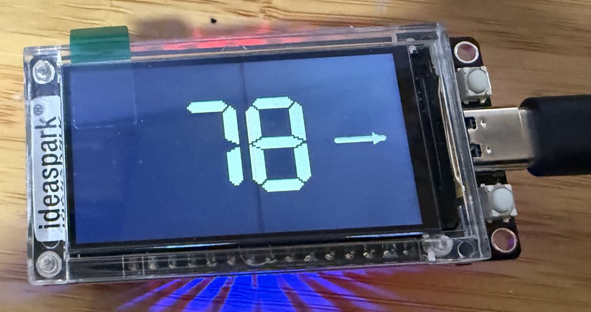
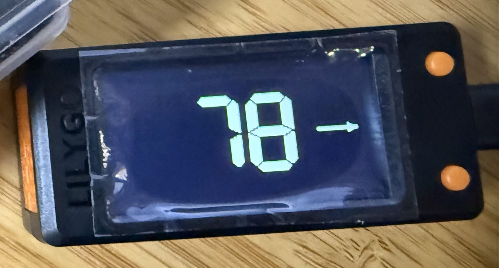
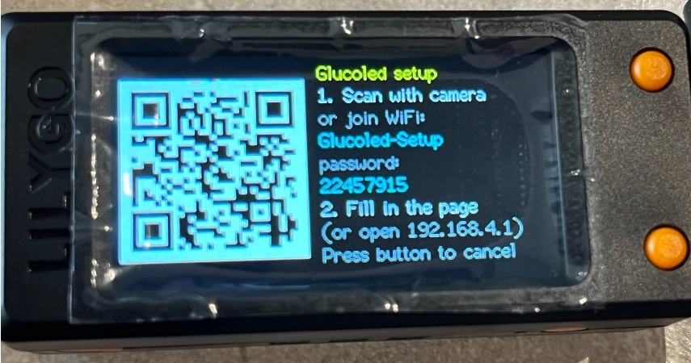
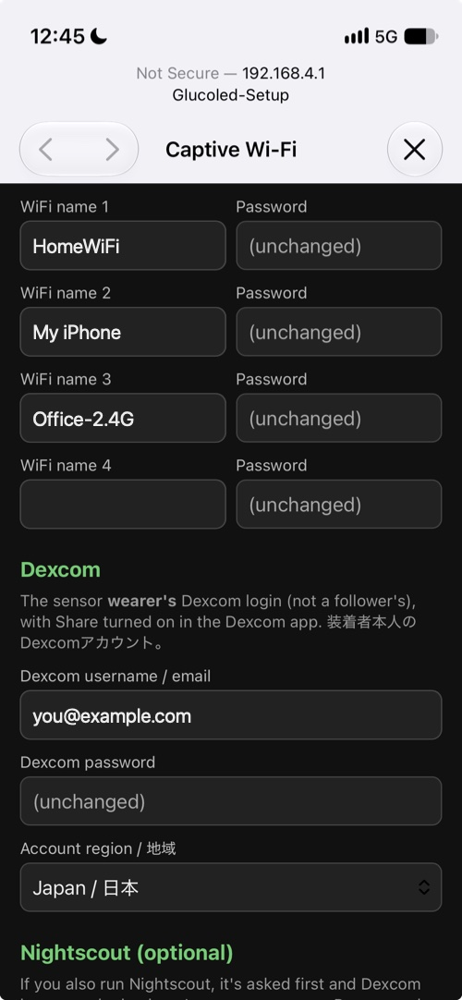
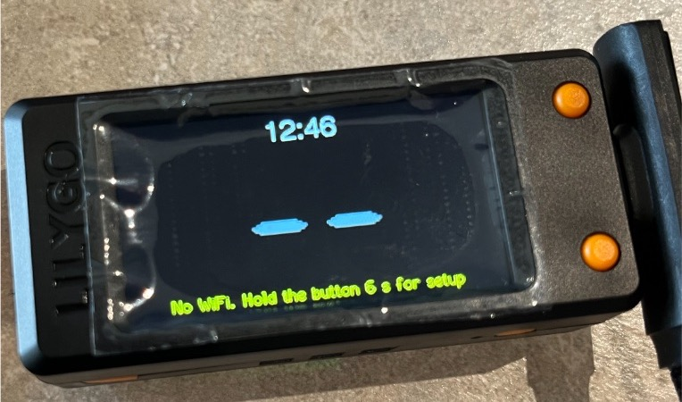

# Glucoled（グルコレッド）

[English](README.md) | 日本語

**血糖値をひと目で確認したい糖尿病の方へ。**

**Dexcom Share**（日本のDexcomアカウント対応）または [Nightscout](https://nightscout.github.io/) から、
**血糖値とトレンド矢印だけ**を表示する小さなディスプレイです。机、車、バイク、ベッドサイドに。
アラームもグラフもアプリもありません。

  
  

> **医療機器ではありません。** Glucoledは確認用の表示器です。治療の判断には使わず、
> CGMアプリ・受信機とそのアラームを使ってください。

## 特長

- 数値と矢印は**範囲ごとに色分け**されます。
  | 血糖値 (mg/dL) | 色 |
  |---|---|
  | 54未満 | 明るい赤 |
  | 54〜69 | 赤 |
  | 70〜180 | 緑 |
  | 181〜250 | 黄 |
  | 250超 | オレンジ |
- 最新の値が**11分以上古い**と**グレー**になります。古い値を今の値と見間違えません。
- 上に**時計**（24時間表示）。インターネットから時刻を合わせます。
- **WiFiを最大4つ**覚えます（自宅とスマホのテザリングなど）。近くにあるものに自動でつながります。
- 費用はボード代だけ：約2,000〜3,000円。

## 必要なもの

- **LilyGO T-Display S3**（1.9インチの通常版。AMOLED・Pro・Long版は不可）。ケース付きがおすすめです。
  [LilyGO公式ストア](https://lilygo.cc/products/t-display-s3?variant=42585826558133)
  ideaspark ESP32 1.9インチボードでも動きます。
- **データ通信できるUSB-Cケーブル**（充電専用ケーブルは不可）
- **ChromeかEdgeが使えるパソコン**（Mac・Windows・Linux。Safariとスマホではインストールできません）
- センサー装着者本人の**Dexcomのメールアドレスとパスワード**
  （Dexcomアプリで「共有」をオンにしておく）

## インストール

**[glucoled.com](https://glucoled.com)** をパソコンのChromeかEdgeで開き、画面の手順に従ってください。
クリックするところすべてに画像付きの説明があります。

1. ボードをUSBでパソコンにつなぎ、**Install Glucoled** を押す。
2. 一覧から **USB JTAG/serial debug unit** の行をクリックして「接続」。
3. メニューが出たら **Install Glucoled**。
4. **Erase device** にチェックのまま **Next**、続けて **Install**。
5. 約2分待つ（ケーブルは抜かない）。完了するとボードにQRコードが表示されます。

## スマホで設定

  
  

1. ボードのQRコードをスマホのカメラで読み取り、**Glucoled-Setup** に接続。
2. 設定画面が自動で開きます（開かない場合はブラウザで `192.168.4.1`）。
3. 入力して **保存して再起動**：
   - **WiFi**：名前とパスワード。車やバイクで使うなら、スマホのテザリングも追加。
   - **Dexcom**：装着者本人のメールアドレスとパスワード。**地域は「Japan / 日本」**。
   - **Nightscout**：使っていなければ空欄でOK。
   - **タイムゾーン**：日本。
4. 約20秒で血糖値が表示されます。スマホのWiFiを元に戻してください。

設定画面は表示中だけ動き、ふだんはWebサーバーなどは動いていません。設定はボードの中だけに保存されます。

### WiFiの注意

- ESP32は **2.4GHzのWiFiのみ**対応です。5GHzにはつながりません。
- **iPhoneのテザリング**：設定 → インターネット共有 → **「互換性を優先」をオン**にしないと見つかりません。

## ボタンの使い方

T-Display S3では、画面を横にしてUSBを右にしたときの**下のボタン（BOOT）**です。

| 操作 | 動作 |
|---|---|
| 短く押す | デバッグ画面（WiFi、通信状態、バージョンなど）。もう一度押すか2分で戻ります |
| 2秒押して離す | Bluetoothログのオン・オフ（下記） |
| **6秒長押し** | **設定画面**（WiFiやDexcomの変更）。設定画面でボタンを押すとキャンセル |

設定画面の **設定を消去** で、すべての設定（Dexcomのパスワードを含む）を消せます。人に譲る前に使ってください。

## 画面の表示

- 右上の **NS** / **D**：値の取得元（Nightscout / Dexcom）。
- 左上の **BT**：Bluetoothログがオン。
- 下に黄色い文字 **「No WiFi. Hold the button 6 s for setup」**：WiFiにつながっていません。6秒長押しで設定し直してください。

  

## DexcomとNightscoutについて

- **Dexcom**：センサーを**装着している本人**のアカウントを使います（フォロワーのアカウントではありません）。
  Dexcomアプリで**共有がオン**になっている必要があります。
- **地域**：日本のアカウントは必ず **Japan / 日本** を選んでください。
  地域が違うと「パスワードが違う」のと同じエラーになります
  （他の多くの表示器が日本のアカウントで使えないのはこのためです）。
- **NightscoutとDexcomの両方**を設定すると、まずNightscoutを見て、値が6分以上古いときだけDexcomも確認し、
  新しい方を表示します。
- Dexcomのログインが拒否されると、アカウントがロックされないよう、設定し直すまで再試行しません。
- Dexcomの非公式Share API（Dexcom Followアプリと同じもの）を使っています。Dexcomの変更で使えなくなる可能性があります。
- **パスワードはボードに保存されます。** ボードとUSBケーブルがあれば読み出せるので、鍵と同じように扱ってください。

## 困ったとき

| 症状 | 対処 |
|---|---|
| インストールで一覧にボードが出ない | 別のUSBケーブルを試す（充電専用が多いです）。だめなら下のボタンを押しながらUSBを差し込み、もう一度。終わったら側面のリセットボタン |
| 「Failed to open serial port」 | 他のタブやアプリ（Arduinoなど）がボードを使っています。閉じて、USBを抜き差しして再試行 |
| 「No WiFi. Hold the button 6 s for setup」 | WiFi名・パスワードの間違いか5GHz。6秒長押しで設定し直す |
| 設定画面が開かない | Glucoled-Setupに接続したまま、ブラウザで `192.168.4.1` を開く。モバイルデータをオフにすると安定します |
| 「--」と表示される | WiFiはOKでも値が取れていません。Dexcomのメール・パスワード・**地域**、アプリの共有設定を確認。短く押してデバッグ画面で理由を確認できます |
| 数値がずっとグレー | 11分以上新しい値がありません。Dexcomアプリが動いて共有しているか確認 |

## ログを見る（Bluetooth）

ボタンを**2秒押して離す**と、左上に青い **BT** が出て、10分間「Glucoled」という名前で接続できます。
スマホの **Bluefruit Connect**（iPhone・Android）で Glucoled → **UART** を開くと、
直近40行のログと新しいログが見られます。読み取り専用で、パスワードやトークンは表示されません。

## 自分でビルドする

Arduinoでのビルド、別のボードへの対応、仕組みの説明は [英語のREADME](README.md) を見てください。

## ライセンス

MIT。[LICENSE](LICENSE) を参照。
