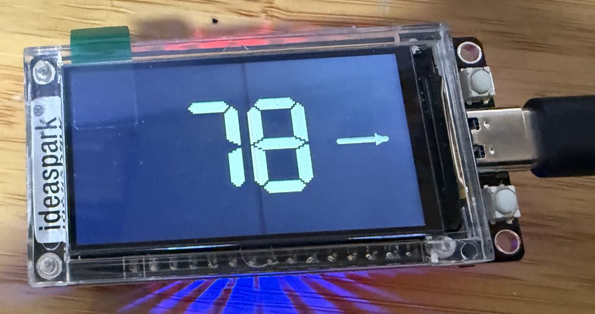
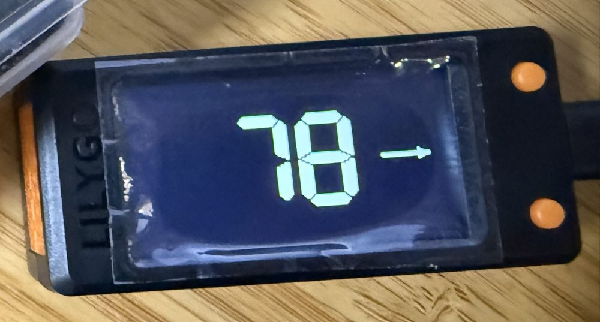

# Glucoled

A tiny desk/car display for your glucose, from [Nightscout](https://nightscout.github.io/) or
straight from **Dexcom Share** (including Japanese Dexcom accounts):
**just the number and the trend arrow**. No alarms, no graphs, no app.

<p align="center">
  
  
</p>

- Number and arrow are **coloured by range**, like Loop Follow's time-in-range chart:
  red under 54, darker red 54–69, green 70–180, yellow 181–250, orange over 250
  (change the cut-offs with `RANGE_VERY_LOW`, `RANGE_LOW`, `RANGE_HIGH`, `RANGE_VERY_HIGH`
  in `secrets.h`).
- **Grey** when the latest reading is older than 11 minutes (or the board doesn't know the
  time yet), so a stale value never looks current.
- Waits up to **15 seconds** for Nightscout to answer, so slow hosted sites (some take ~5 s
  on a cold request) don't make it give up.
- Shows the **time** (HH:MM) above the number, set from the internet, so it doubles as a desk clock.
- Remembers **several WiFi networks**, e.g. home + your phone's hotspot for the car.
- Total cost is the board: about ¥2,000 / US$15.

> **Not a medical device.** Glucoled is a convenience display. Don't make treatment
> decisions from it. Use your CGM app / receiver and its alarms.

## Boards

Both boards are tested and run the same code. Pick one:

| Board | Where | Notes |
|---|---|---|
| **ideaspark ESP32 1.9" ST7789 170×320** (ESP32-WROOM-32, CH340 USB-C) | Amazon JP, ~¥2,000 | Default. Power from USB or a USB power bank. |
| **LilyGO T-Display S3** (ESP32-S3, 1.9" 170×320) | AliExpress / LilyGO, ~US$15 | Has a battery connector with charging and two buttons. |

Use a USB-C **data** cable. Charge-only cables won't show the board.
No USB driver is needed on recent macOS.

## Setup

### 1. Install the tools (once)

[arduino-cli](https://arduino.github.io/arduino-cli/), plus the ESP32 core and two libraries:

```sh
brew install arduino-cli          # or see the arduino-cli docs for Windows/Linux
arduino-cli config init
arduino-cli config add board_manager.additional_urls \
  https://raw.githubusercontent.com/espressif/arduino-esp32/gh-pages/package_esp32_index.json
arduino-cli core update-index
arduino-cli core install esp32:esp32@3.2.0
arduino-cli lib install "TFT_eSPI@2.5.43" "ArduinoJson@7.4.3"
```

On Apple Silicon Macs, the Arduino toolchain still needs Rosetta for one helper (ctags):
`softwareupdate --install-rosetta --agree-to-license`.

You do **not** need to edit the TFT_eSPI library's `User_Setup.h`. Each board's pins live
in `board_*.h` here, and `build.sh` passes the right one in.

### 2. Your settings

```sh
cp secrets.example.h secrets.h
```

Edit `secrets.h`. It is gitignored, so it never gets committed.

```c
#define SECRET_WIFI_NETWORKS \
  {"HomeWiFi",       "home-password"}, \
  {"My iPhone",      "hotspot-password"}
#define SECRET_NS_HOST   "yoursite.example.com"   // no https://, no trailing slash
#define SECRET_NS_TOKEN  ""                        // see below
```

And/or read Dexcom directly:

```c
#define SECRET_DEXCOM_USER   "you@example.com"
#define SECRET_DEXCOM_PASS   "your-dexcom-password"
#define SECRET_DEXCOM_REGION "jp"     // "us", "ous" (outside the US) or "jp" (Japan)
```

- **WiFi:** list one `{"name", "password"}` per line, ending every line except the last with
  `, \`. The board joins whichever listed network is strongest and switches if it drops.
  Emoji names work, but they must match byte for byte. Typing them as escapes avoids editor
  trouble, e.g. `"\U0001F422"` for 🐢.
- **iPhone hotspot:** the ESP32 only does 2.4 GHz WiFi. Turn on
  *Settings → Personal Hotspot → Maximize Compatibility*, or the board won't see it.
- **Time zone:** the clock defaults to Japan (`JST-9`). Elsewhere, add a POSIX TZ string, e.g.
  `#define SECRET_TZ "PST8PDT,M3.2.0,M11.1.0"` (US Pacific) or `"GMT0BST,M3.5.0/1,M10.5.0"` (UK).
- **Token:** leave it empty if your Nightscout site can be read without logging in (the
  default `AUTH_DEFAULT_ROLES=readable`). Otherwise create a token with the `readable` role
  under *Admin Tools → Subjects* and paste it here. Never use your API_SECRET.
- **Sources:** set Nightscout, Dexcom, or both. With both, Nightscout is asked first (it's
  usually fastest when an uploader like Trio/Loop/xDrip is running). If its reading is missing
  or 6+ minutes old (the uploader missed one), Dexcom is asked too and the newer reading is
  shown. A small **NS** or **D** in the top-right corner shows where the number came from.
- **Dexcom:**
  - Use the **sensor wearer's** Dexcom login, the one the Dexcom app is signed into, not a
    follower's. **Share must be on** in the Dexcom app.
  - Pick the region the account lives in. Japanese accounts only work with `"jp"` (many other
    displays only know the US and international servers, so they reject Japanese logins).
  - If the password contains `"` or `\`, put a backslash before it, e.g. `"pa\"ss"`.
  - Your Dexcom **password is stored on the board**. Anyone with the board and a USB cable could
    read it out, so treat the board like a key.
  - This uses Dexcom's unofficial Share API (the one the Follow app uses, as in
    [pydexcom](https://github.com/gagebenne/pydexcom)). Dexcom could change it at any time.
  - If Dexcom rejects the login, Glucoled stops trying until you restart it, so a wrong password
    can't lock your account.

### 3. Build and flash

Plug in **one** board, then:

```sh
./build.sh upload                    # ideaspark (default)
BOARD=tdisplays3 ./build.sh upload   # LilyGO T-Display S3
```

`./build.sh` without `upload` only compiles. The port is auto-detected; override it with
`PORT=/dev/cu.xxx`.

After flashing, the screen shows "Connecting WiFi...", then your number within about 20 seconds.
It refreshes every 60 seconds.

## Troubleshooting

| Symptom | Fix |
|---|---|
| `board not found` | Use a data cable, or try another port/hub. |
| Stuck on "Connecting WiFi..." | Check the WiFi name/password (exact spelling), and that it's 2.4 GHz. |
| `--` instead of a number | WiFi works, but the data source didn't answer. Open the debug page (below) for the reason. Nightscout: check `SECRET_NS_HOST` and the token. Dexcom: check the login, region and that Share is on. |
| Number is always grey | No new reading for 11+ minutes. Check Nightscout itself, or that the Dexcom app is running and sharing. |
| Colours inverted (ideaspark) | In `board_ideaspark_19.h`, swap `TFT_INVERSION_ON` for `TFT_INVERSION_OFF`. |

## Debugging

Three ways to see what it's doing. None of them open a network port.

- **USB log:** plug it into a computer and run
  `arduino-cli monitor -p <port> -c baudrate=115200`. It shows WiFi joins and drops, each Nightscout
  fetch (HTTP code, how long it took, the reading) and why a fetch failed.
- **Debug page:** a **short press** of the BOOT button (GPIO0; on the T-Display S3, the lower orange button with the screen landscape and USB on the right) switches to a status screen: WiFi network, signal and
  IP, the last Nightscout result and timing, fetch counts, uptime and free memory. Press again,
  or wait 2 minutes, to go back.
- **Bluetooth log:** **hold** the BOOT button for 2 seconds. A blue `BT` appears top-left, and for
  10 minutes the board advertises as "Glucoled". In *Bluefruit Connect* (iOS/Android), tap
  Glucoled, then **UART**. On Android, *Serial Bluetooth Terminal* also works. You get the last 40
  log lines and then live ones. (Generic BLE apps like *nRF Connect* show only raw packets, and
  their "parsers" decode the text as nonsense heart-rate or glucose values.) It's read-only and stays on while a phone is connected.
  Hold the button again to turn it off.

The log never includes your token, Nightscout address or WiFi passwords. It does include
WiFi network names.

## Adding another board

Any ESP32 with a display supported by [TFT_eSPI](https://github.com/Bodmer/TFT_eSPI) should work:

1. Copy one of the `board_*.h` files and fill in the pins. TFT_eSPI's `User_Setups/` folder
   has ready-made ones for many boards.
2. Add a line to the `case` in `build.sh` with its header and Arduino board ID (FQBN).

Drawing uses the screen's own width and height, so the sketch itself shouldn't need changes.
If the board gates display power on a pin (like the T-Display S3's GPIO15), define
`BOARD_POWER_PIN` in its header.

## How it works

Every 60 s it fetches the latest reading and computes its age against NTP time.

- **Nightscout:** `https://<host>/api/v1/entries/sgv.json?count=1`, keeping only `sgv`, `date`
  and `direction`. The certificate isn't verified (`setInsecure()`), which keeps setup simple.
  The worst case is someone on your network showing you a fake number, so don't rely on it for
  treatment (see above).
- **Dexcom Share:** logs in once (account ID, then session ID), then reads the latest value with
  that session until it expires. Because this sends your password, the server certificate
  **is** verified, against the root CAs in `dexcom_roots.h`.

## License

MIT. See [LICENSE](LICENSE).
