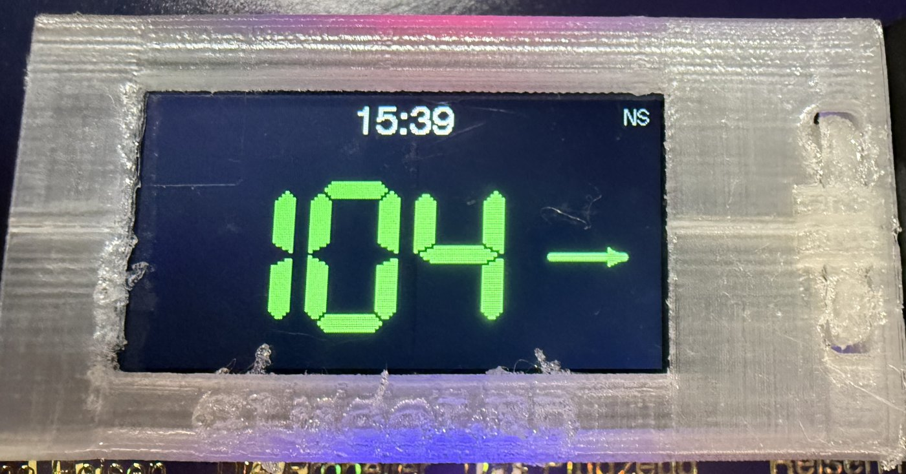

# 3D-printed case: ideaspark ESP32 1.9"

A slide-in case for the ideaspark board, with **GlucoLED** under the screen.

<p align="center">
  
</p>

Based on [BOX for Ideaspark ESP32 DEV BOARD](https://www.thingiverse.com/thing:6940341) by
**PS_Diegooz**, licensed [CC BY-SA](https://creativecommons.org/licenses/by-sa/4.0/). These files are a
modified version under the same license. The rest of the Glucoled repo is MIT.

| File | Size (mm) | Print |
|---|---|---|
| `glucoled-ideaspark-body.stl` | 36.5 × 20 × 69.5 | Standing on its closed (USB) end, as exported |
| `glucoled-ideaspark-body-plain.stl` | 36.5 × 20 × 69.5 | Same body without the text |
| `glucoled-ideaspark-plug.stl` | 15 × 32.6 × 6 | Closes the open end |
| `glucoled-ideaspark-stand.stl` | 46 × 13 × 9 | Optional desk stand |

Fits the board as it ships, in its clear acrylic plates with the header pins soldered. Slide it in screen
first toward the window, with USB toward the closed end.

Changes from the original:

- Converted from inches to millimetres; body and end plug are separate files.
- Inside width 32.3 → 32.8 mm for printing slack; plug widened to match. Depth stays 15.2 mm, which keeps
  the USB port lined up with its opening (a 16.6 mm test print let the board sit too far back).
- "GlucoLED" in Courier New Bold, raised 0.6 mm, on the strip under the screen.

To rebuild after changing a setting in `make_case.py` (macOS, for the Courier New font):

```
python3 -m venv .venv && .venv/bin/pip install manifold3d fonttools numpy
.venv/bin/python make_case.py
```
